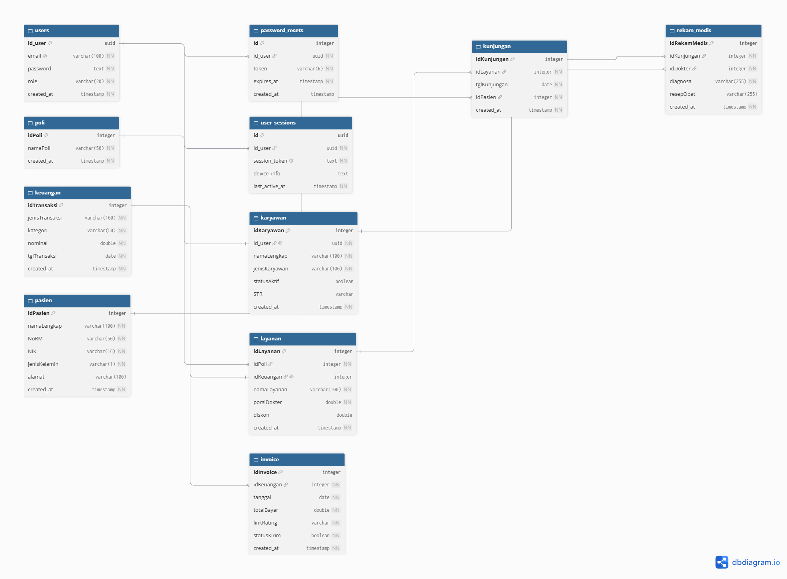

# SIM-Klinik

SIM-Klinik adalah sistem informasi manajemen klinik yang dirancang untuk mempermudah pengelolaan data pasien, jadwal dokter, dan layanan klinik secara efisien. Sistem ini dibangun menggunakan teknologi modern untuk memberikan pengalaman pengguna yang optimal.

---

## 📂 Struktur Folder

```
sistem-informasi-tuberkulosis/
├─ action/                   # Fungsi aksi server-side untuk pemrosesan data
├─ app/                      # Route dan layout aplikasi berbasis Next.js App Router
├─ components/               # Komponen UI yang dapat digunakan kembali
├─ database/                 # Konfigurasi koneksi MySQL (Connection Pool)
├─ docs/                     # Dokumentasi proyek dan panduan penggunaan aplikasi
├─ libs/                     # Library internal maupun eksternal yang digunakan dalam proyek
├─ messages/                 # terjemahan pesan dan teks untuk berbagai bahasa (i18n)
├─ public/                   # Aset statis seperti gambar, ikon, dan file publik
├─ schemas/                  # Skema validasi data menggunakan Zod
├─ services/                 # Layer pemanggilan API dan layanan bisnis
├─ style/                    # File CSS global dan tema
├─ types/                    # Definisi tipe TypeScript
├─ utils/                    # Fungsi utilitas dan helper
├─ .env.example              # Contoh file environment
├─ .gitignore                # File untuk mengabaikan file tertentu saat commit
├─ AGENTS.md                 # Next.js Agent Rules
├─ eslint.config.mjs         # Konfigurasi ESLint
├─ next.config.js            # Konfigurasi Next.js
├─ package-lock.json         # File lock dependensi npm
├─ package.json              # Daftar dependency dan script proyek
├─ proxy.ts                  # Middleware Next.js untuk autentikasi dan otorisasi
├─ README.md                 # Panduan proyek dan dokumentasi
└─ tsconfig.json             # Konfigurasi TypeScript
```

Penjelasan singkat

- app/ digunakan untuk mendefinisikan halaman dan layout aplikasi.
- components/ berisi komponen UI yang bersifat reusable.
- database/ berisi konfigurasi koneksi database dan skema database beserta data dummy.
- libs/ berisi library internal maupun eksternal yang digunakan dalam proyek.
- services/ berisi logika bisnis dan pemanggilan API.
- types/ berisi definisi tipe data TypeScript.
- utils/ berisi helper, utilitas, dan konfigurasi umum.

---

## 🗄️ Schema Database

Skema database dikelola menggunakan sistem relasional MySQL. Semua perubahan struktur tabel didokumentasikan melalui file kueri SQL.



Relasi Inti:

Aturan Umum Schema:

- Gunakan INT AUTO_INCREMENT atau VARCHAR(255) untuk primary key (tergantung kebutuhan UUID atau ID urut).
- Gunakan DATETIME untuk kolom tanggal dan waktu (wajib selaras dengan zona waktu Z atau UTC pada pengaturan aplikasi).
- Beri NOT NULL pada kolom yang wajib diisi.
- Tambahkan indeks (KEY atau INDEX) pada kolom yang sering dipakai untuk memfilter atau menggabungkan (join) tabel.

---
